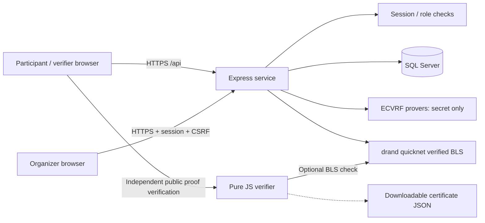
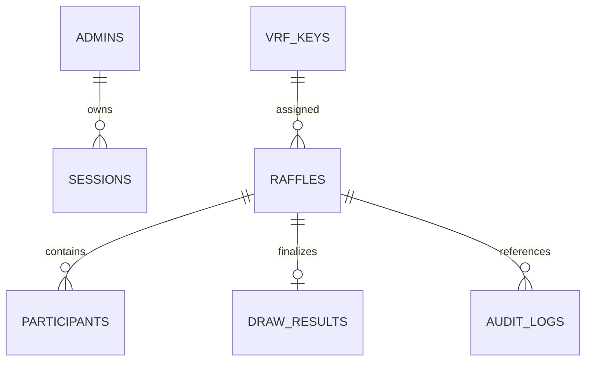

# Architecture and Protocol Data Flow (Phases 1–5)



```mermaid
sequenceDiagram
  participant O as Organizer
  participant P as Public
  participant S as Server
  participant D as Database
  participant B as drand Quicknet
  O->>S: Create raffle + future time
  S->>D: Store PK ID and beacon round
  P->>S: Register public participant code
  S->>D: Insert if OPEN (row locked)
  O->>S: Lock roster
  S->>D: Freeze canonical roster + commitment
  S-->>P: Public commitment hash
  Note over P: Independent timestamp required
  Note over B: Future round is produced
  O->>S: Draw after round
  S->>D: Claim LOCKED -> DRAWING atomically
  S->>B: Fetch beacon via verified drand client
  B-->>S: BLS-verified randomness + signature
  S->>S: Encode alpha; ECVRF prove; select index
  S->>D: Single result row + DRAWN status (transaction)
  P->>S: Fetch certificate
  S-->>P: Public key, proof, input, roster, winner
  P->>P: Recompute VRF, hash, winner (offline)
  P->>B: Verify BLS beacon separately (optional online)
```

## Trust boundaries

- Browser input is untrusted; server enforces field validation, login controls, concurrency rules, and SQL Server constraints.
- Server controls the ECVRF private key; only the server can create the next proof. It cannot change a valid proof for the *same* key and input without detection.
- Server may lie about when it published the roster. Offsite timestamp evidence is a separate trust dependency.
- drand public randomness is external to the server. The published signature needs independent BLS verification against the pinned Quicknet chain identity.
- Public verifier deliberately does not call server's `/api/verify` endpoint, although that endpoint is provided for API examples.

## Database entity model



`raffles.status`: OPEN -> LOCKED -> DRAWING -> DRAWN. An interrupted DRAWING state can return to LOCKED after 10 minutes if no result exists. A unique draw_results.raffle_id prohibits duplicate finalization.

## Protocol input boundaries

`veridraw-v1`: UTF-8 string fields, each prefixed by uint32BE byte length. Domain labels guard against accidental cross-protocol reuse. Roster sorts bytewise on lowercase ASCII participant IDs, hashes stable ID/name pairs, uses SHA-256. Alpha binds the raffle UUID, key ID, roster hash, external chain source, round, and signed beacon output. The winner uses SHA-256 counter expansion from beta and uniform 64-bit rejection sampling. The UI must not treat JavaScript's Math.random() or `index = beta % N` as secure raffle selection.
